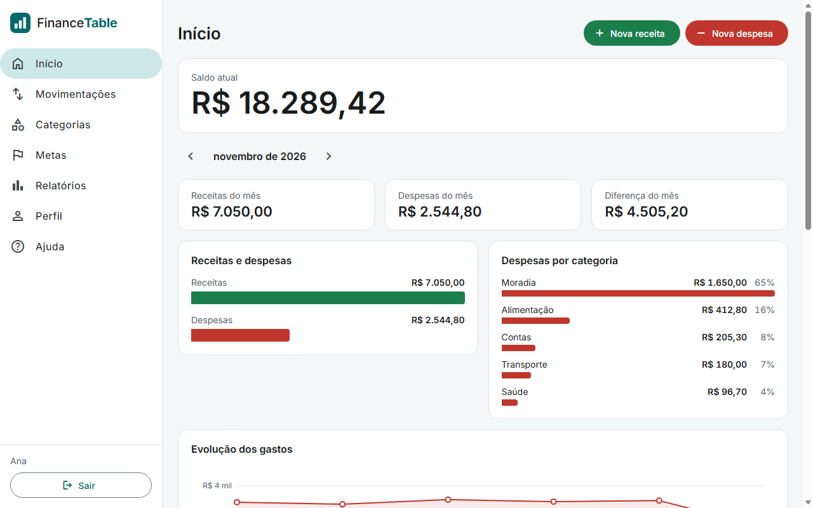
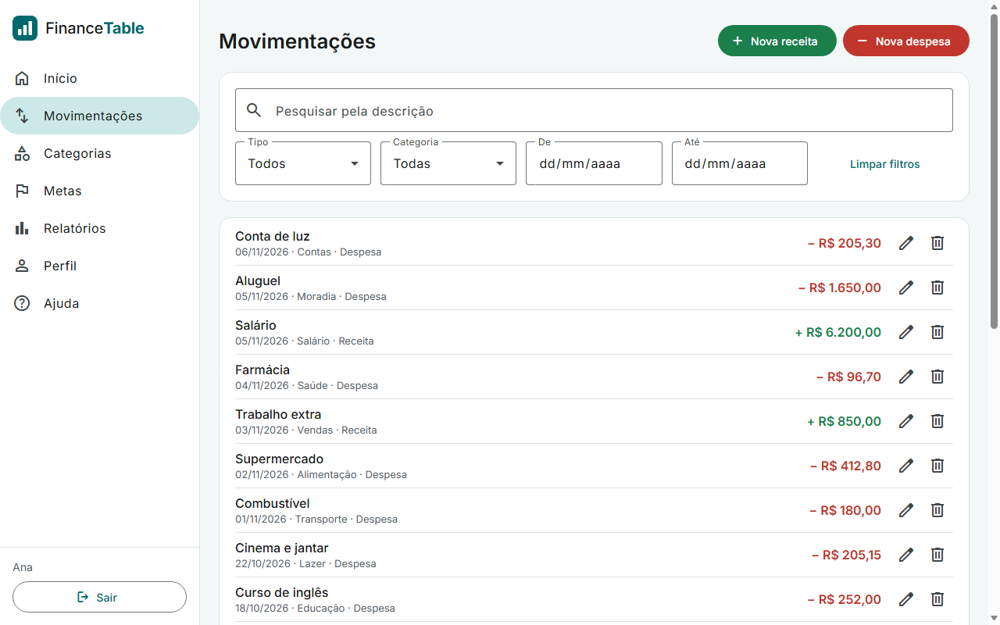
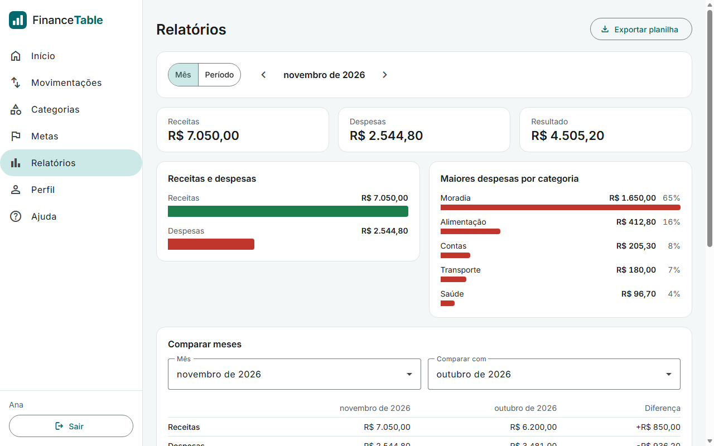
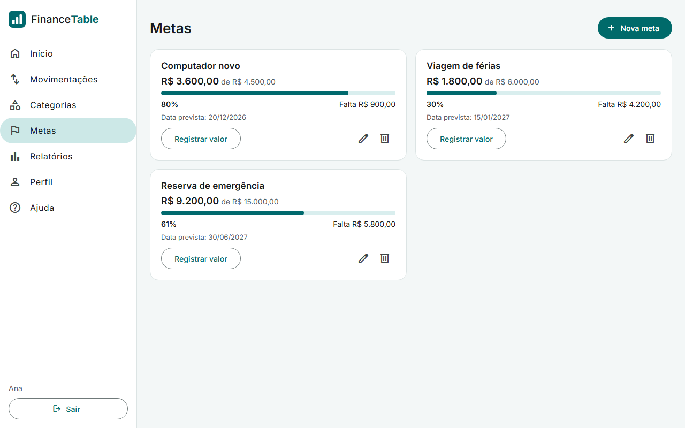
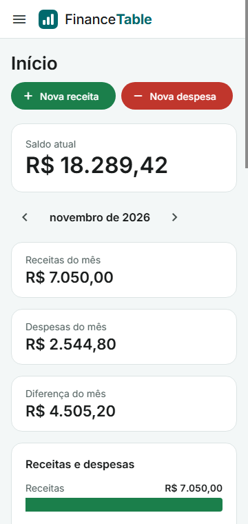

# FinanceTable

Plataforma de controle financeiro pessoal: registre receitas e despesas, organize por categorias, acompanhe metas e consulte relatórios.

Projeto de portfólio, feito para rodar na sua máquina com um único comando.



## Como testar

Você só precisa do [Docker Desktop](https://www.docker.com/products/docker-desktop/) aberto. Na raiz do projeto, rode:

```sh
docker compose --profile app up --build
```

Na primeira vez, a construção da imagem leva alguns minutos. Depois, abra:

| Endereço | O que é |
|---|---|
| http://localhost:8080 | A aplicação. Comece criando uma conta. |
| http://localhost:8025 | Caixa de e-mails de teste, onde chega o link de recuperação de senha. Nada é enviado de verdade. |

Para parar, use `Ctrl+C`. Para parar e apagar os dados de teste, rode `docker compose --profile app down -v`.

Se a porta 8080 estiver ocupada, escolha outra definindo a variável `APP_PORT`, por exemplo `APP_PORT=8090` no arquivo `.env`.

## Funcionalidades

- **Conta:** cadastro, login, logout, recuperação de senha por e-mail, alteração de nome e de senha.
- **Movimentações:** receitas e despesas, com pesquisa, filtros por tipo, categoria e período, e paginação.
- **Categorias:** categorias prontas ao criar a conta e categorias próprias. Uma categoria em uso não pode ser excluída.
- **Início:** saldo atual, totais do mês, gráficos, últimas movimentações e metas em andamento.
- **Metas:** objetivos com valor, data prevista e progresso.
- **Relatórios:** consulta por mês ou período, comparação entre dois meses e exportação em CSV pronta para o Excel em português.
- **Ajuda:** instruções de uso dentro da própria aplicação.
- **Telas adaptadas** para computador, tablet e celular.

| Movimentações | Relatórios |
|---|---|
|  |  |

| Metas | Celular |
|---|---|
|  |  |

As capturas usam dados fictícios.

## Tecnologias

| Parte | Tecnologia |
|---|---|
| Backend (`backend/`) | Java 21, Spring Boot 4, Spring Security, Spring Session, JPA, Flyway |
| Frontend (`frontend/`) | Angular 22 com signals, Angular Material |
| Banco de dados | PostgreSQL 17 |
| Testes | JUnit, MockMvc e Testcontainers no backend; Vitest no frontend |
| Execução | Docker e Docker Compose |

## Decisões técnicas

- **Sessão no banco, com cookie `HttpOnly`.** O JavaScript não tem acesso à sessão, e sair da conta ou redefinir a senha encerra o acesso na hora. Alterações exigem o token CSRF, que o Angular envia automaticamente.
- **Isolamento entre contas.** Toda consulta é filtrada pelo usuário logado, e os testes de integração cobrem o acesso aos dados de outra conta.
- **Limite de tentativas** em login, cadastro e recuperação de senha, com os valores em `app.limits` no `application.yaml`. O bloqueio de login considera o e-mail junto do IP, para ninguém conseguir bloquear a conta de outra pessoa. Os contadores ficam em memória, o que basta para uma instância.
- **Recuperação de senha sem revelar contas.** A resposta é a mesma para e-mails cadastrados ou não, e o link é guardado no banco apenas como hash, vale por 30 minutos e só pode ser usado uma vez.
- **CSV seguro para o Excel.** Descrições que começam com `=`, `+`, `-` ou `@` são exportadas como texto, para não serem executadas como fórmula.
- **Cabeçalhos de segurança.** Há uma política de conteúdo (CSP), e o `Referrer-Policy` impede que o token do link de recuperação vaze para outros sites.
- **Uma só imagem.** O Spring serve o Angular compilado na mesma origem da API, sem precisar de CORS.
- **Banco versionado.** As tabelas são criadas pelas migrações do Flyway em `backend/src/main/resources/db/migration`.

## Para desenvolver

Você precisa de Java 21, Node 24 e Docker Desktop aberto. Use um terminal para cada passo:

```sh
# 1. Na raiz do projeto: banco de dados e caixa de e-mails
docker compose up -d

# 2. Backend, em http://localhost:8080 (cria as tabelas sozinho)
cd backend
./mvnw spring-boot:run

# 3. Frontend, em http://localhost:4200 (na primeira vez, rode npm install antes)
cd frontend
npm start
```

No Windows, use `.\mvnw.cmd` no lugar de `./mvnw`. Para mudar os padrões, veja as variáveis em [.env.example](.env.example).

## Testes

```sh
# Backend: precisa do Docker aberto, pois sobe um PostgreSQL temporário próprio
cd backend
./mvnw test

# Frontend
cd frontend
npm test -- --watch=false
npm run build
```

## Documentação

O que a plataforma deve fazer e as etapas de desenvolvimento estão no [manual](docs/manual.md). Ele usa o nome de trabalho "FinanceFlow"; o nome final do projeto é FinanceTable.
